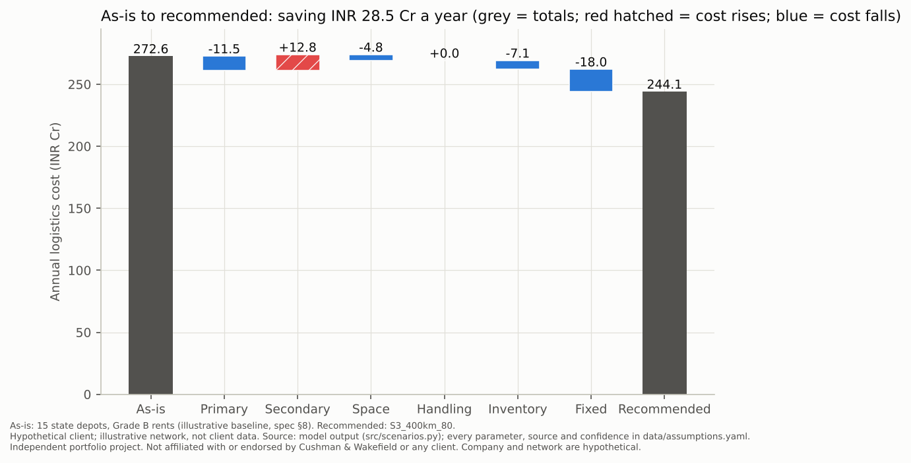
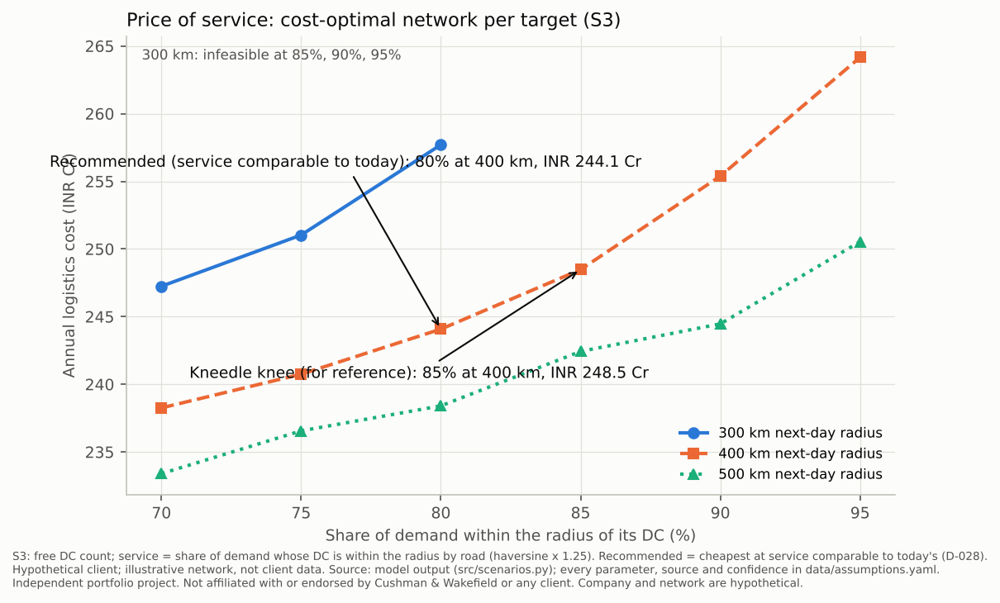
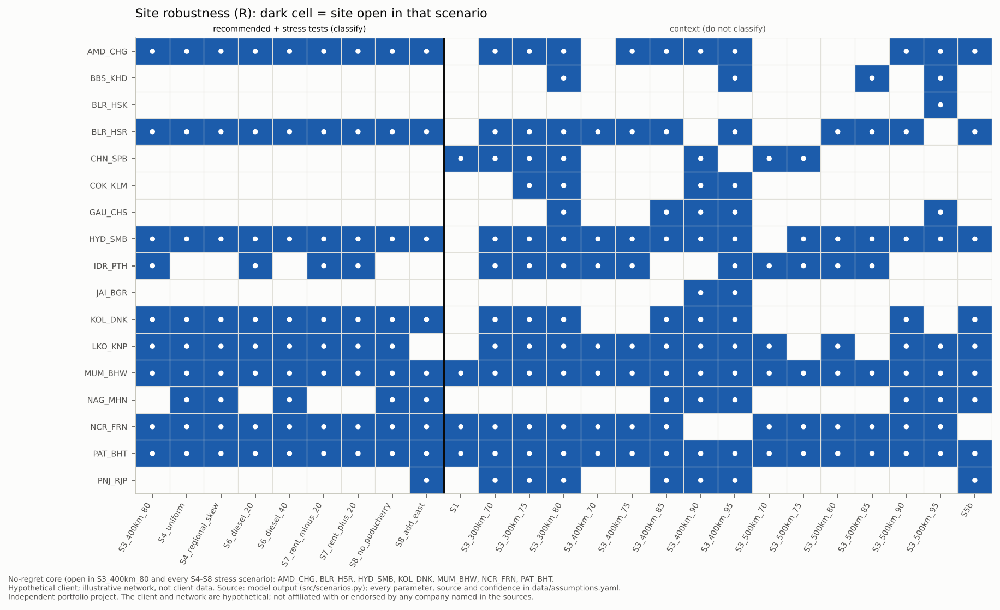
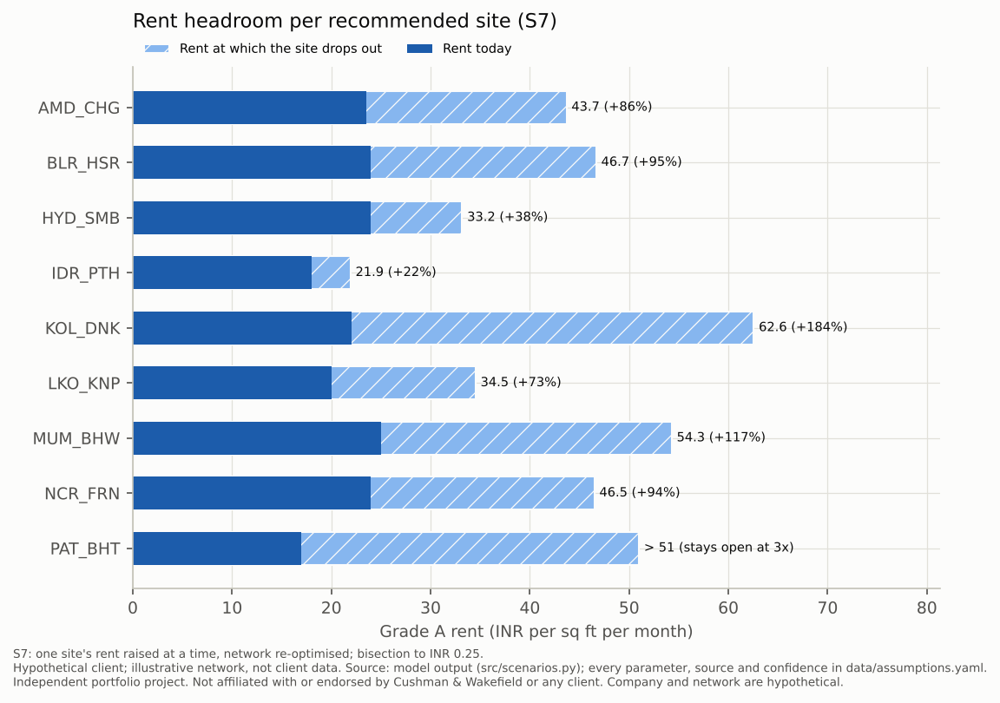
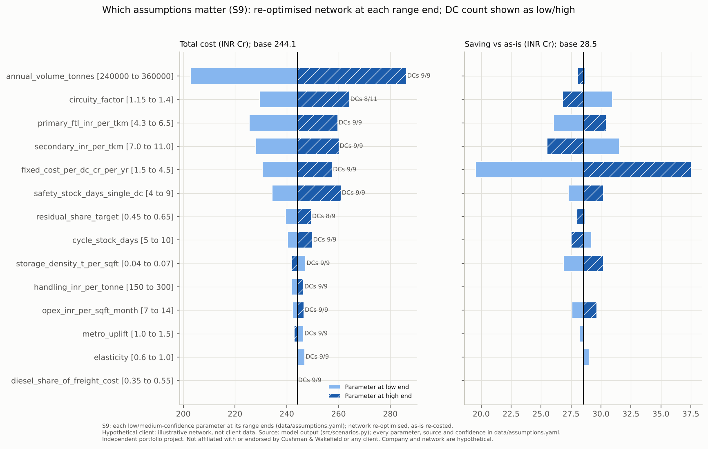

# India distribution network design

**How many distribution centres should a national FMCG brand run in India, where, and which markets should each serve, at minimum landed cost with a next-day service promise?** This repository answers that question end to end. It contains a facility-location optimisation in Python, every scenario a steering committee would ask for, and a what-if agent that answers questions by running the model.

> Independent portfolio project. Not affiliated with or endorsed by Cushman & Wakefield or any client. The company, its plants and today's network are hypothetical. All costs are in INR Cr a year.

**Live demo:** https://india-distribution-network-design-kz6nnhvwavjuo6opn7kappq.streamlit.app/ (it opens in offline mode; live mode needs your own free key entered in the sidebar, which is never stored)

**Read the two-page summary:** [`docs/case_study.pdf`](docs/case_study.pdf) · **Full scenario write-up:** [`docs/scenario_insights.md`](docs/scenario_insights.md)

---

## The answer

**Run 9 DCs:** Bhiwandi (Mumbai), Farrukhnagar (NCR), Hosur (Bengaluru), Shamshabad (Hyderabad), Changodar (Ahmedabad), Dankuni (Kolkata), Kanpur Road (Lucknow), Pithampur (Indore) and Bihta (Patna).

| | Today: 15 state depots | Recommended: 9 DCs |
|---|---|---|
| Annual logistics cost | INR 272.6 Cr | **INR 244.1 Cr** (4.1% of revenue) |
| Demand reached next-day (within 400 km by road) | 81.4% | **80.1%** (99.1% within 900 km) |
| Saving | | **INR 28.5 Cr a year (10.5%)** at comparable service |

The recommendation is the cheapest network at today's service level, so the saving is like for like rather than bought with worse service (decision D-028). It can be built in three stages:

1. **Commit now to 7 no-regret sites:** Mumbai, NCR, Hosur, Shamshabad, Ahmedabad, Kolkata and Patna. They stay open in every stress test.
2. **Reach 80% next-day service** by adding Lucknow and one central-India site.
3. **Upgrade to 85%** by adding Guwahati and Rajpura, for **+INR 4.4 Cr a year for +5 points** of next-day coverage. That upgrade uses Nagpur rather than Indore as the central site. Picking Nagpur at step 2 costs +INR 0.3 Cr a year and makes the upgrade purely additive.

## What the scenarios say

### 1. Consolidation pays because fixed cost, inventory and inbound freight fall faster than last-mile freight rises



Fewer, larger DCs give up INR 12.8 Cr of last-mile freight. In return they save 18.0 Cr of fixed cost, 11.5 Cr of primary freight, 7.1 Cr of inventory (safety stock is pooled under the square-root law) and 4.8 Cr of space.

### 2. Service has a rising price, and "next-day" must be defined before the DC count



- **No service target.** The cheapest network has 4 DCs and costs INR 231.2 Cr, but reaches only 49.4% of demand next-day.
- **Rising steps.** On the 400 km frontier each further five points costs more than the last: +4.4 Cr from 80% to 85%, +6.9 Cr to 90% and +8.8 Cr to 95%.
- **Above 85% the network re-shapes rather than grows.** NCR closes in favour of Jaipur and Rajpura.
- **A 300 km promise** cannot be met above 80%, because 15% of demand lies more than 300 km from every candidate cluster.

### 3. Seven sites are robust; the real risk is an outage, not a lost lease



- **Stress tests.** The core survives +30% demand growth, ±20% rents, +20% and +40% diesel, and both plant-footprint variants. The only recurring swing is the central site: Indore wins on rent, Nagpur on freight.
- **NCR lost for good** costs only INR 2.2 Cr a year once the network is re-optimised around Rajpura.
- **NCR shut for a month** costs at least INR 2.4 Cr in extra freight. That is a floor, because lost sales and stranded stock are not costed. Next-day coverage falls from 80.1% to 64.0% across 29 zones. The answer is a documented North contingency, not a tenth DC.

### 4. Real estate is a small share of cost, but it decides one site



- **Rents overall.** Moving every rent ±20% moves total cost by about ±1.2% (±2.8 to 2.9 Cr), and no site changes.
- **Patna and Kolkata** stay open even at three times today's rent, so their low-confidence rents do not change the answer.
- **Indore** can absorb only 22% more rent before the central site moves. That makes Indore the first location for a rent survey.

### 5. Which assumptions matter



- **Volume** moves total cost most (INR 203 to 286 Cr), but it scales today's cost too, so the saving barely moves (28.1 to 28.7 Cr).
- **Circuity** (road km per straight-line km) is the one input that changes the DC count: 8 DCs at 1.15, 11 DCs at 1.40.
- **Fixed cost per DC** decides the size of the business case. At INR 1.5 to 4.5 Cr per site, the saving ranges from 19.5 to 37.5 Cr a year.

A simple k-centre-of-gravity network costs 3 to 11% more than the optimised one at the same DC count (6.3%, about 15 Cr a year, at 9 DCs).

## Approach

| Step | What it does | Where |
|---|---|---|
| **Data** | Census 2011 city, district and state populations, cleaned of known defects; 158 demand zones carrying 300,000 t a year | `src/data_prep.py`, `src/demand.py` |
| **Distances** | Great-circle distance × 1.25 circuity, calibrated within 15% on 7 reference road pairs; North-East routed via Siliguri | `src/geo.py` |
| **Cost engine** | One exact evaluator covering primary and secondary freight, space, handling, square-root-law inventory and fixed cost. Every reported figure comes from it. | `src/costs.py` |
| **Optimiser** | Capacitated facility-location MILP (PuLP + CBC): single sourcing, DC capacity, one site per metro, next-day service share. Free solves run twice to size the safety-stock proxy (D-034). | `src/model.py` |
| **Today's network** | 15 state depots in Grade B space, costed on the same engine | `src/baseline.py` |
| **Scenarios** | S0 to S9: as-is, cost-only, DC count, service frontier, growth, disruption, fuel, rent, plant footprint, tornado; no-regret analysis; centre-of-gravity comparison | `src/scenarios.py`, `src/robustness.py` |

Every parameter lives in [`data/assumptions.yaml`](data/assumptions.yaml) with its unit, source, confidence and range. `python -m src.scenarios` rebuilds every number, chart and map from the raw data in about 11 minutes. Modelling choices are logged in [`docs/DECISIONS.md`](docs/DECISIONS.md).

## The what-if agent

`streamlit run app/streamlit_app.py` opens a chat on the left and the current network on the right: a map plus a cost-by-component chart against the recommended network. Ask, for example, *"What if Hosur shuts for a month?"* The agent calls the model through seven tools (run a scenario, simulate a disruption, compare or explain networks, look up an assumption's source, rank assumptions, list parameters) and explains the trade-off.

Guardrails:
- **Grounding.** Every number in a reply must round from a tool result. A reply that fails is sent back once; if it fails again, the answer is built straight from the tool results.
- **Citations.** Every answer cites its scenario ids.
- **Refusals.** Overrides more than 2× the range width outside `assumptions.yaml` are refused, with the accepted range.
- **Caching and limits.** Results are cached by a hash of the arguments, and the agent may make at most 6 tool calls per question.

**Offline mode** is the default. It answers 20 pre-computed questions with no network and no key; see [`docs/agent_demo_transcripts.md`](docs/agent_demo_transcripts.md). **Live mode** works with any OpenAI-compatible chat API that supports tool calling.

## Run it locally

You need Python 3.11 or later. The setup scripts create a virtual environment, install `requirements.txt`, check that the bundled CBC solver works, and copy `.env.example` to `.env` (never overwriting an existing `.env`).

```bash
# macOS / Linux
scripts/setup_local.sh                 # venv in .venv/ (or pass a path)
source .venv/bin/activate
```

```powershell
# Windows: the venv goes outside OneDrive by default (C:\venvs\scnd; -VenvPath to change)
powershell -ExecutionPolicy Bypass -File scripts\setup_local.ps1
C:\venvs\scnd\Scripts\activate
```

Then, from the repository root:

```bash
pytest -q                              # fast tests (about 5 s)
streamlit run app/streamlit_app.py     # the agent, offline unless a key is set
python -m src.agent --offline          # the five demo questions as a transcript
python -m src.scenarios                # optional: rebuild every result from raw data
```

## Live mode with your own key

The app never ships with a key. Two ways to go live:

- **In the app.** Open the sidebar's *Live mode* panel, pick a provider (Gemini, Groq, any other OpenAI-compatible endpoint, or a local Ollama model when running locally), check the prefilled base URL and model, paste your key, and press **Use this key**.
  - The key lives only in that browser session's memory. It is never written to disk, logs, the result cache, transcripts or the URL. Provider errors are shown with anything key-like redacted.
  - **Forget key** clears it.
  - The sidebar shows where the active key came from ("key entered here" or "your .env"), never the key itself.
- **Locally, in `.env`.** Set `LLM_BASE_URL`, `LLM_MODEL` and `LLM_API_KEY` in your git-ignored `.env`; `.env.example` has presets. Gemini keys must be AI Studio keys (https://aistudio.google.com/apikey).

Use a restricted, free-tier key. Your key is sent only to the provider you choose.

## Deploy (Streamlit Community Cloud)

The app reads only committed files: `data/processed/`, `outputs/scenarios/` and the offline library `outputs/agent_library.json`. It starts in seconds with nothing to rebuild. PuLP 3.x (pinned below 4) bundles the CBC solver for Linux, so no system packages are needed.

1. Sign in at https://share.streamlit.io with GitHub and choose **Create app → Deploy a public app from GitHub**.
2. Set the repository to `Shubham-Kakade/india-distribution-network-design`, the branch to `main`, and the main file path to `app/streamlit_app.py`.
3. Under **Advanced settings**, set the Python version to 3.11 (3.12 also works) and paste exactly this into **Secrets**:
   ```toml
   PUBLIC_DEMO = "1"
   ```
   **Do not add any API key secret.** With `PUBLIC_DEMO=1` the app ignores every `LLM_*` variable and `.env`, hides the local Ollama option, and only calls `https` endpoints on public hosts. It can therefore only ever use a visitor's own key.
4. Press **Deploy**. The first build installs `requirements.txt` (a few minutes).
5. Check the sidebar. It should show *Mode: offline* and *Key: none*, and the provider list should not include Local Ollama.

## Troubleshooting

- **macOS:** if the CBC solver is not found, run `brew install cbc`.
- **Windows:** create the venv outside OneDrive (the setup script does this by default).
- **Gemini:** keys must be AI Studio auth keys; otherwise Google returns 403 `API_KEY_SERVICE_BLOCKED`.
- **Free tiers may return 429** (rate limited); the app then falls back to offline with a notice.

## Limitations

- **Demand** is built from Census 2011 population shares and a single aggregated product. Zones in rural-heavy states are lumpy, with one zone covering 18 to 36 million people.
- **Distances** are straight-line × 1.25 rather than real road distances. Circuity is the one parameter that moves the DC count.
- **Hypothetical inputs.** The plants, today's network and several rents (Lucknow, Indore, Jaipur, Rajpura, Patna, Kochi, Bhubaneswar) are hypothetical or analyst estimates.
- **Inventory in the optimiser** is a linear proxy. Every reported figure is the exact evaluator cost.
- **Outage costs** are floors, because lost sales and stranded stock are not modelled.
- **Live mode** has been tested with mocked clients. A live provider demo is to be recorded locally (D-043).

## Next steps on a real engagement

1. Client shipment data and SKU-level demand.
2. Actual lane rates and road distances.
3. Overhead per site from the client's books.
4. A site visit for the central-India swing (Indore or Nagpur).
5. C&W MarketBeat availability and rent checks for the low-confidence clusters.
6. Model plant allocation jointly with the network. The sourcing footprint is worth as much as the whole DC consolidation saving: losing the Puducherry plant costs +28.4 Cr a year, and an eastern plant saves 33.1 Cr.

## Repository map

```
app/streamlit_app.py      what-if agent front end (chat, map, cost chart, bring-your-own-key)
src/                      config, data_prep, demand, geo, costs (the one cost engine), model (MILP),
                          baseline, cog, scenarios, robustness, reporting, viz,
                          agent_tools, agent, agent_offline, llm_settings
tests/                    one test file per module; tiny fixtures; slow full-India tests marked
data/raw/                 untouched inputs (+ manual fixes)    data/processed/  generated tables
data/assumptions.yaml     every parameter with unit, source, confidence and range
outputs/                  scenario JSON and summary CSV, charts, maps, offline agent library
docs/                     case study (md + pdf), scenario insights, decisions, progress, spec,
                          demo transcripts, sources
scripts/                  setup_local.sh / .ps1, build_case_study_pdf.py (one-off)
```

## Disclaimer

Independent portfolio project by Shubham Kakade, not affiliated with or endorsed by Cushman & Wakefield or any client. The company, its plants, its current network and all results are hypothetical and illustrative. Public sources are listed in [`docs/sources.md`](docs/sources.md).
